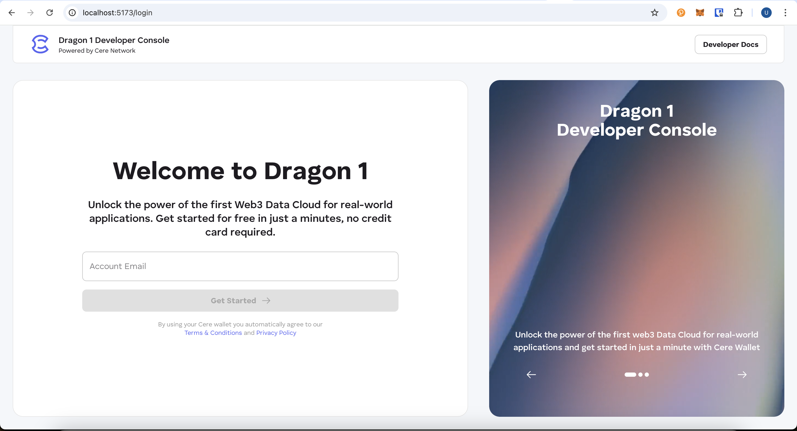

# Developer Console

- [Project structure](./STRUCTURE.md)

## Run it locally, against devnet

From the repository root (Node 22.13.0, `.nvmrc`):

1. Install dependencies:

   ```
   npm i
   ```

2. Copy the devnet environment file (Dragon 1 devnet: the blockchain index, the DDC S3 gateway, the inference,
   compute, reconciliation and payment services, and the devnet wallet):

   ```
   cp .env.dev .env
   ```

3. Start the console:

   ```
   npm run start -w apps/developer-console
   ```

4. Open http://localhost:5173/ (Vite takes the next free port, such as 5174, when 5173 is busy; it prints the URL).

`.env.dev` holds the same values as the deployed devnet console's `/config.js`:

| Variable | Devnet value |
| --- | --- |
| `VITE_NETWORK` | `devnet` |
| `VITE_WALLET_ORIGIN` | `https://wallet.compute.dev.ddcdragon.com` |
| `VITE_BLOCKCHAIN_INDEX_URL` | `https://storage.devnet.dragon-1.xyz` |
| `VITE_DDC_S3_GATEWAY_URL` | `https://ddc-s3-gateway.compute.dev.ddcdragon.com` |
| `VITE_DDC_CDN_URL` | `https://cdn.devnet.dragon-1.xyz` |
| `VITE_DDC_CLUSTER_ID` | `0x7f82864e4f097e63d04cc279e4d8d2eb45a42ffa` |
| `VITE_INFERENCE_GATEWAY_URL` | `https://inference-gateway.compute.dev.ddcdragon.com` |
| `VITE_MODELS_CDN_URL` | `https://cdn.dragon-1.xyz` |
| `VITE_RECON_URL` | `https://reconciliation-service.compute.dev.ddcdragon.com` |
| `VITE_PAYMENT_URL` | `https://payment-service.compute.dev.ddcdragon.com` |
| `VITE_COMPUTE_GATEWAY_URL` | `https://agent-gateway.compute.dev.ddcdragon.com` |

A deployed console reads these from `/config.js` (the `cef-developer-console` Helm chart) instead; `src/config.ts`
and the slices under `src/storage`, `src/inference`, `src/billing` and `src/compute` say which key is which.
Sandboxes and Agents run only on devnet: with another network (`.env.stage` is testnet, `.env.prod` mainnet) those
pages say there is no compute gateway for it, rather than mixing one network's buckets with another's gateway.

### Signing in

The SSCP wallet signs in with a passkey, which a browser offers only on https, and the devnet wallet accepts a
framed sign-in only from the origins it lists (`https://localhost:5173`, `https://localhost:3000`,
`https://localhost:3002` among them). Serve the console over https on one of those ports with a local certificate
(for example from `mkcert localhost`):

```
DEV_HTTPS_CERT=$HOME/.certs/localhost.pem DEV_HTTPS_KEY=$HOME/.certs/localhost-key.pem \
  npm run start -w apps/developer-console -- --port 5173 --strictPort
```

Over plain http the wallet falls back to a popup (`transport downgraded to "popup"`), and a passkey prompt does not
appear.

- You should be able to see the Welcome page

  
